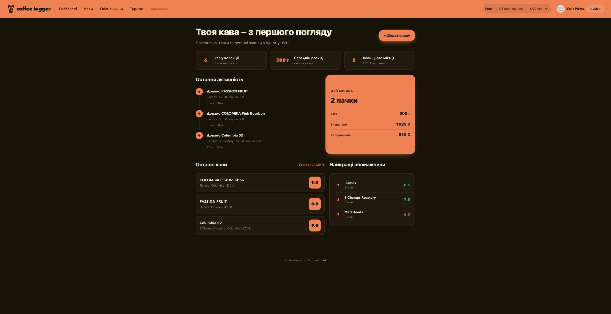

# coffee logger

A private coffee journal for tracking beans, roasters, purchases, ratings, and brews.



## Features

- Google OAuth with per-user data isolation
- Coffee catalog with search, filters, and sorting
- Roaster and processing-method management
- Coffee ratings, purchase details, status, and brew journal
- Dashboard with monthly usage, spending, recent activity, and top roasters
- Free-plan usage limits enforced on the server

## Stack

- Next.js 15 and React 18
- Auth.js with Google OAuth
- Prisma and PostgreSQL
- Vercel deployment

## Local setup

Requirements: Node.js and PostgreSQL.

```bash
cp .env.example .env
npm install
npm run db:push
npm run dev
```

Open <http://localhost:3000>.

Required environment variables:

```env
DATABASE_URL=
DIRECT_URL=
AUTH_GOOGLE_ID=
AUTH_GOOGLE_SECRET=
AUTH_SECRET=
AUTH_URL=http://localhost:3000
AUTH_TRUST_HOST=true
```

Generate `AUTH_SECRET` with:

```bash
openssl rand -base64 32
```

## Commands

```bash
npm test                 # Run tests
npm run build            # Create a production build
npm run db:seed          # Add demo data
npm run db:reset         # Reset and seed the database
npm run db:claim-owner   # Assign legacy records to a Google account
```

Deployment instructions: [DEPLOY.md](DEPLOY.md).
